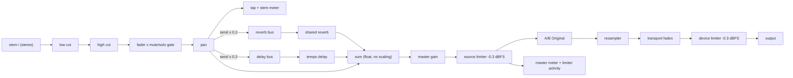
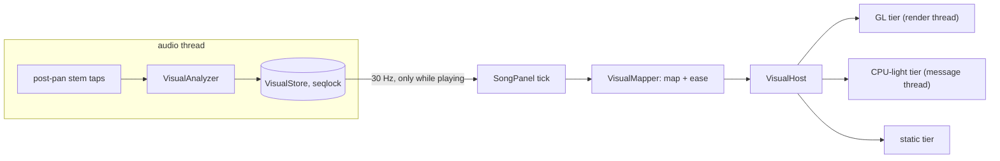

# SNDS app architecture

This document covers the C++ app. The wire contract with the Python worker and the cache schema
are in `docs/protocol.md`.

## Targets

- `snds_core` (static library): all SNDS code plus the JUCE modules, compiled once.
- `SNDS`: the desktop app (`src/app/Main.cpp`). `snds_tests`: a JUCE `UnitTestRunner` console app.
  It doubles as the scripted fake worker for process tests (see below).

## Threading and ownership

- The **message thread** owns the UI, `Settings`, and every controller. Anything that arrives from
  another thread is posted to it; nothing blocks it.
- Worker jobs run in `WorkerProcess`: one supervisor thread (launch, wait, cancel, kill), one
  stdout reader, one stderr reader. Events reach the owner through a dispatcher (the message
  thread by default), in order, and never after the owner is destroyed. The destructor terminates
  the process tree and joins, which takes milliseconds.
- The audio thread (Phase 3+) never touches files, logging, the worker, or the cache.

## Worker process model (`src/app/WorkerProcess.*`)

1. `CreateProcessW` suspended, with stdin/stdout/stderr pipes. Only the three child pipe ends are
   inherited (`PROC_THREAD_ATTRIBUTE_HANDLE_LIST`).
2. Assigned to a Job Object with `KILL_ON_JOB_CLOSE` before it is resumed, so the whole tree (uv's
   launcher `python.exe` starts the real interpreter) dies with the app or on `TerminateJobObject`.
3. The request is written as the first stdin line; stdin stays open for the whole job.
4. stdout lines become `worker::Event` values (`parseEventLine`). Unparsable lines and unknown
   event types are counted and logged. An unsupported `protocol` kills the job
   (`protocolViolation`).
5. stderr is drained into the app log (redacted) and `jobs\<id>\worker-stderr.log`.
6. **Cancel**: `{"type":"cancel"}` then stdin close; after `cancelGraceMs` the job is terminated
   with exit code 99. The overall `timeoutMs` takes the same path.
7. When the main process exits, the job is terminated too, so a straggler cannot hold the pipes.
   The outcome is `resolveJobOutcome(exitCode, terminalEvent)`; the app does not wait for stderr EOF
   to decide it.
8. After any outcome but success, audio files in the job folder are deleted; logs stay.

Tests run real processes: the test executable copied as `python.exe` plays a scripted worker
(`SNDS_FAKE_WORKER` mode, passed via `WorkerProcessOptions::extraEnvironment`).

## BPM

`bpm.value` in `song.json` may be `null` (detection failed; the job still succeeds, `bpm.error`
says why). The app treats that as "not detected" and uses `SongMetadata::defaultBpm` (120) as a
flagged default until the user sets a tempo.

## Fingerprint, cache, and import (Phase 2)

- `validateSourceFile` (`model/SongImport`) checks WAV (PCM 16/24/32, float32) and MP3, mono or
  stereo, 8 to 192 kHz, at most 30 minutes. `extractEmbeddedArtwork` / `makeFallbackArtwork`
  (`model/Artwork`) supply the artwork step; the result is an `ArtworkChoice` written to
  `jobs\<id>\artwork.<ext>`.
- `computeFingerprint` / `FingerprintJob` (`model/SourceFingerprint`) hash the source with
  Windows CNG on a background thread, with progress and cancel. The cache key is
  `<sha256>-<sizeBytes>`.
- `CacheStore` (`app/CacheStore`) lists `SNDS_HOME\cache` entries (`complete | incompatible |
  corrupt` from `loadSongPackage`), deletes entries (song.json first), and quarantines abandoned
  `jobs\*` folders: `package` and audio go, logs and the app's own files stay. A running job is
  protected by an **active mark** taken *before* its folder is created
  (`CacheStore::markJobActive`). The app runs a quarantine pass at start-up on a background
  task, before any job exists.
- `OriginalLocations` remembers where a song's original was confirmed
  (`SNDS_HOME\originals.json`, key to path). `song.json` is never rewritten for this.

## The song session (`app/SongSession`)

One class owns the import flow on the message thread; everything slow runs elsewhere and comes
back through the dispatcher (the message thread in the app, a test queue in tests).

```
importSong -> validate + read embedded art (AsyncTask) -> fingerprint (FingerprintJob, progress)
  -> cache lookup
       playable        -> open it (no artwork question, no worker)
       incompatible /
       corrupt         -> removeNonPlayableEntry, then continue
  -> awaitingArtwork   (UI: Use this / Choose image... / Use default artwork)
  -> provideArtwork    -> mark job active, create jobs\<id>, write artwork, WorkerProcess prepare
       stage/progress events -> overall progress (separation is 80% of the weight)
       result          -> verify the entry is playable, delete jobs\<id>, open
       cancelled/kill  -> delete jobs\<id>; a package published just before the cancel is opened
       failure         -> message + guidance by code; cache_conflict removes the entry and offers
                          "Try again"; retry_cpu offers "Retry on CPU"; jobs\<id> stays on
                          failures for diagnosis (worker-stderr.log), quarantine cleans audio
       crash/protocol  -> failure with stderr tail; jobs\<id> kept
```

The artwork question comes after the cache lookup, not before: a song that is already prepared
needs no new artwork and opens straight away.

Opening a package never needs the original. `OpenSong::originalAvailable` is true if the original
is found (the file just imported, a remembered location, or `source.path`) and still has the
recorded size; otherwise the song opens with the stems usable, Original A/B marked unavailable,
and `Locate Original...`. `locateOriginal` accepts a file only when its size and SHA-256 match the
cache key. `Settings.forceCpu` becomes `compute.preference: "cpu"`; `retryOnCpu` forces it once.

The UI (`ui/ImportPanel`, `ui/SongPanel`, `ui/ArtworkConfirmationPanel`) displays
`SessionStatus` / `OpenSong` and forwards user actions; it holds no flow logic.

Tests: `SongSessionTests` drive the whole flow against the scripted fake worker; `snds_tests
--e2e` (`EndToEndTests.cpp`, opt-in) runs the same session against the real worker in a scratch
`SNDS_HOME` (`SNDS_E2E_HOME`, `SNDS_E2E_TRACK`).

## Playback in the app (Phase 3)

`AudioService` (owned by the application object, created before the window, started after it
unless `--smoke-exit*` or `--no-audio`) holds the `PlaybackEngine`, the JUCE `AudioDeviceManager`
and the `AudioDeviceController`. `MainComponent` receives a pointer and builds a
`PlaybackController` for the song panel's `TransportBar`.

- **Opening a song** (`SongSession::onSongOpened` -> `PlaybackController::setSong`): on a
  background task the four stems are opened and checked against `song.json` (rate, stereo, frame
  count); if the original is available its content hash and size must match the cached source
  before `planOriginal` verifies its alignment (MP3 gapless
  offset + cross-correlation, summary logged). The prepared song is handed to the engine, paused
  at the start. A song prepared before the device is up waits for it. Opening the same song again
  (the original was located) keeps the playhead.
- **Views, not logic, in the UI**: `TransportBar` polls `PlaybackController::view()` at 20 Hz.
  States: unloaded, preparing (also "waiting for an audio device"), ready, playing, paused,
  failed (a stem is unusable); orthogonally the original is checking / available / missing /
  unusable (A/B disabled, with the reason) and the device is running / fallback / lost / failed.
  A lost device disables Play but not seeking.
- **Cache deletion**: `SessionEnvironment::beforeCacheRemoval` runs before the session removes any
  cache entry; the app unloads the engine for that key so no stream keeps the files open.
- **Audio settings**: the header button opens `AudioSettingsComponent` (JUCE's selector, output
  only). It is closed, and the engine unloaded, before `AudioService` is destroyed.

## Audio threading contract (Phase 3)

**Who runs what**

| Thread | Runs | Never does |
|---|---|---|
| Audio callback (the device's thread) | `PlaybackEngine::process` and, inside it, the stem mix stage, the A/B crossfade and the resampler | see "The callback never" below |
| Prefetch thread (one per loaded song) | `PrefetchThread`: the only caller of `FrameSource::read` (WAV/MP3 decoding, disk) | touch the transport or the mix |
| Message thread | UI, `PlaybackController`, `AudioDeviceController`, `load`/`unload`/`prepare`/`seek`/`play`/`pause`/`setLooping`/`setOriginalSelected`/`deviceStopped`, parameter writes, logging | run `process` |
| Background tasks (`AsyncTask`) | opening stems, `planOriginal` (decode + FFT correlation) | touch the engine; results return through the dispatcher |

**The callback never** allocates or frees heap memory, reads or writes files, talks to the worker,
logs, calls the renderer or any UI/JUCE message-manager code, waits (event, sleep, join) or takes
a lock it can block on. The only lock it touches is `PlaybackEngine::sessionLock`, with
`tryEnter`: if the control thread is swapping the song (or re-preparing after a device change), the
block is silence and the callback moves on.

**How threads talk**

| From -> to | Mechanism |
|---|---|
| message -> audio | atomics: `playing`, `looping`, `originalWanted`, `pendingSeek`; the shared `SeekTarget` (one word: 24-bit generation + 40-bit frame, CAS-published); the Phase 4 `ParameterStore` snapshot (seqlock read) |
| prefetch -> audio | one SPSC ring per stream; `published`/`consumed` counters carry the seek generation, a seqlock-style re-check after each copy rejects frames a flush may have overwritten; no locks |
| audio -> message/UI/visuals | atomics only: position, `buffering`, `audible`, `reachedEnd`, underrun count, `MeterStore` |
| message <-> audio (song swap) | `sessionLock`: the control side holds it for a pointer swap, `prepare` and `deviceStopped`; the audio side only try-locks |

**Transport rules.** One clock, in source-rate frames, is the position authority for all streams
(the source frame time of the next device frame, read from the resampler). A seek is one new
generation in the shared `SeekTarget`: it reaches every stream or none. While playing, the audio
thread fades out (10 ms), publishes the seek itself, and every stream refills; playback resumes
only when all streams hold safe read-ahead (250 ms). Each chunk is read from all streams or from
none, so an underrun is silence plus a re-buffer, never skew.

**Obligations for what plugs in.**
- The stem mix stage (`StemMixStage`, `dsp::MixProcessor`) obeys the callback rules: allocate in
  `prepare()` only; read parameters from the snapshot; publish levels through atomics.
- Phase 5 visuals read `MeterStore` and the post-fader stem tap through lock-free snapshots; the
  renderer must never call into the engine, wait on the audio thread, or hold anything the
  callback needs.
- Anything that allocates or waits (opening files, planning, logging, UI) stays on the message
  thread or a background task.

**Automated audit (`tests/cpp/AudioCallbackAuditTests.cpp`, `snds_tests --filter AuditCallback`).**
The test executable replaces the global `operator new`/`delete` (and, in Debug, hooks the CRT's
malloc) with counters that are active only on a thread while it is inside `process()`. The test
thread acts as the audio thread and drives the callback through: every stem-only block size,
stereo and mono output, six resampling ratios (44.1/48/96/192 kHz to 48/44.1/96 kHz), Original/Stem
Mix toggling and the crossfade, looping and the end-of-song tail, 150 random seeks, pauses, stops
and loop toggles, starvation and re-buffering, idle states (no song, paused, after a device
stop), and the Phase 4 `MixProcessor` installed through `setMixStageFactory` with live parameter
writes. Any allocation or release fails the test. The same run records which threads call
`FrameSource::read` and which log: neither may be the callback thread. Inserting an allocation
into the render path makes it fail (checked when the audit was written).

Not covered by the audit: execution time (no deadline measurement), page faults, and the
absence of blocking locks and waits, which rest on code review (`process` has one `tryEnter` and
no other synchronisation primitive). A new audio-thread path needs a scenario added to the audit.

## The interactive mix (Phase 4, `src/dsp/`)

`dsp::MixProcessor` turns the four aligned stems into one limited stereo mix. It runs at the
**source** sample rate (44.1 to 192 kHz), before the single resampler, and its three audio-facing
methods match `audio::StemMixStage` exactly:

```cpp
explicit MixProcessor (ParameterStore& parameters);                // parameters outlive the processor
void prepare (double sourceRate, int maxBlockFrames);              // not real-time safe; allocates all
void reset() noexcept;                                             // after a seek, loop wrap or load
void process (const std::array<const float* const*, 4>& stems,     // drums, bass, other, vocals; [ch][frame]
              float* const* output, int numFrames) noexcept;       // 2 ch; any numFrames (chunked inside)
```

**Signal flow, per block**



The stems are summed as `((s0 + s1) + s2) + s3`, then the reverb and delay returns. In the default
state (every control at its default, effects silent) the result equals the plain stem sum bit for
bit while the limiter is idle (tested at 44.1/48/96/192 kHz).

**Parameters** (`MixParameters.h`, 38 values, stable IDs; ranges are part of the contract)

| ID | Range | Default | Smoothing |
|---|---|---|---|
| `stem.<drums\|bass\|other\|vocals>.gain` | -60 (= -inf) to +6 dB | 0 dB | 20 ms |
| `.mute`, `.solo` | off / on | off | 10 ms |
| `.pan` | -1 to +1 | 0 (center) | 20 ms |
| `.lowCut` | 20 Hz to 1 kHz, log; **20 Hz = bypassed** | 20 Hz | 30 ms |
| `.highCut` | 500 Hz to 20 kHz, log; **20 kHz = bypassed** | 20 kHz | 30 ms |
| `.reverbSend`, `.delaySend` | 0 to 1 | 0 | 20 ms |
| `fx.reverb.return`, `fx.delay.return` | 0 to 1 | 1 | 20 ms |
| `fx.delay.division` | 1/4, 1/8, dotted 1/8, 1/8T, 1/16 (0 to 4) | 1/8 | crossfade 50 ms |
| `fx.delay.feedback` | 0 to **0.6** | 0.35 | 30 ms |
| `master.gain` | -60 (= -inf) to +6 dB | 0 dB | 20 ms |
| `tempo.bpm` | 20 to 400 (`halveTempo`/`doubleTempo` helpers) | 120 | crossfade 50 ms |

Mix state is **ephemeral**: nothing here is persisted. The app resets the `ParameterStore`
(`resetToDefaults()`, one transaction) when a song opens, then the engine calls `reset()`.
Feedback was lowered from 0.9 to 0.6 and every send carries a fixed -14 dB pad (`sendBusPad`); see
"Headroom" below. Values are clamped on write (NaN becomes the default), toggles and choices snap
to integers, and `formatDisplay`/`formatExact`/`parseValue` give the UI its text.

**Stages**
- *Solo and mute* (`stemAudibility`): with no solo, every unmuted stem plays; with any solo, only
  soloed stems play; **mute always wins** (a stem both muted and soloed is silent, and its solo
  still counts, so the other unsoloed stems stay silent too). The truth table is tested exhaustively.
- *Pan*: constant-power, unity at the center: `gainL = sqrt2 cos(theta)`, `gainR = sqrt2
  sin(theta)`, `theta = (pan + 1) pi/4`. A hard-panned stem is +3 dB on its side and silent on the
  other. `getPanPosition(stem)` is the smoothed pan, always in [-1, 1].
- *Filters*: 2nd-order Butterworth (12 dB/oct) TPT state-variable filters, double precision, with
  exponential cutoff smoothing. The -3 dB point sits on the cutoff at every rate. At the endpoint
  the filter is bypassed bit-exactly; entering or leaving the bypass crossfades over 30 ms.
- *Reverb*: one `juce::Reverb` (Freeverb), fully wet, fixed room 0.6 and damping 0.5; only the
  return level is live.
- *Delay*: stereo feedback delay with whole-sample delays, sized in `prepare` for 20 BPM at 1/4
  (3 s). Time changes crossfade between two read taps (equal power, 50 ms); a change during a
  crossfade waits for it to finish. The loop has a 30 Hz DC blocker and a 7 kHz low-pass (first
  echo clean, repeats darker). Samples entering the loop and the reverb are sanitised (NaN, inf
  and |x| > 1e4 become silence).
- *Master and limiter*: master gain, then a zero-latency stereo-linked peak limiter at **-0.3
  dBFS**. At or below the ceiling the signal passes untouched. An over is scaled to the ceiling
  instantly (so the output can never exceed it and the mix stays sample-aligned with the original),
  then the gain recovers over 100 ms and snaps back to exactly 1. The cost of zero latency is that
  heavy overs are hard-limited, so they should be rare (see "Headroom").
- *Device-output protection*: `PlaybackEngine` uses another `MasterStage` at unity gain after
  resampling and transport fades. It catches interpolation peaks and protects both Stem Mix and
  Original with the same -0.3 dBFS sample ceiling. It adds no lookahead or latency, links stereo
  gain, resets at seeks and device-rate changes, and performs no allocation or locking. This is
  a device-sample ceiling, not an oversampled DAC true-peak guarantee.

**Threads.** The message thread writes controls into the `ParameterStore` at any time. Writers are
serialised by a mutex the audio thread never touches. Publication is a seqlock of relaxed atomic
floats, so one `process()` call sees one consistent snapshot (a whole `setMany` or
`resetToDefaults`, or none of it), never blocks, and keeps its previous snapshot if it collides
with a write. Every audible parameter ramps to the new snapshot, so changing controls cannot
click. `process`, `reset` and `meters().read()` allocate nothing and take no locks; `prepare`
allocates.

**Metering and the Phase 5 hooks**
- `meters()` returns a `MeterStore`: per stem the post-filter, post-fader, post-pan **peak** and
  **RMS**, the source-rate master peak and RMS, `limiterInputPeak` and `limiterReductionDb`. The
  final device limiter's additional reduction is not part of this snapshot. One audio-thread
  writer publishes a whole `MeterSnapshot` through a seqlock. Any thread calls
  `read(MeterSnapshot&)`, and `false` (a write kept colliding) means "keep the last values".
- Ballistics are fixed and independent of block size: peak has instant attack and a 300 ms
  release; RMS is a 300 ms one-pole average of the power over both channels.
- `lastStemSignals()` and `lastFrameCount()` give the four post-pan stereo signals of the latest
  chunk, valid on the audio thread until the next `process()`. This is the hook for per-stem
  analysis. `getPanPosition(stem)` is readable from any thread.

**Headroom and what the UI should say about the limiter**
- The internal sum is plain float with no scaling, so four full-scale stems can reach +12 dBFS
  before the source limiter. That limiter controls the hot mix; the final device limiter also
  catches conversion peaks and protects Original.
- Effects are budgeted so they add little on top. Each send has a -14 dB pad, the reverb returns
  about 0.7x a noise send's level at return 1, and feedback is capped at 0.6 (a tone at the
  delay's resonance builds up to at most 2.5x). Measured with four full-scale noise stems, every
  send and return at maximum and master at 0 dB, the effects add about 1.7 to 1.9 dB to the dry
  peak (about +13.8 dBFS in total). The worst case, four 800 Hz sines at the delay's resonance
  with everything at maximum, peaks at about +18 dBFS before the limiter (it was +40 dBFS with
  feedback 0.9 and no pad).
- **UI guidance.** The limiter must not hide a mix that is too hot, so it is metered, not just
  applied. Show `limiterActive()` (reduction of at least 0.1 dB, held with the peak release) as a
  visible indicator next to the master meter, and show `limiterReductionDb` while it is active.
  When the indicator stays lit, suggest lowering master gain, stem gains or the effect sends.
  `limiterInputPeak` above `limiterCeiling` (0.966) is the same condition in level terms. The
  master meter reads the output, which never exceeds the ceiling, so it cannot show overs by itself.

**Verification** (`tests/cpp/Dsp*Tests.cpp`, `snds_tests --filter DSP`; test names start with "DSP")

| Test | Covers |
|---|---|
| `DspParameterTests` | IDs, ranges, defaults, clamping, text round trips, store snapshot consistency under two concurrent writers |
| `DspStemLevelTests` | solo/mute truth table, gain, pan law, click-free ramps, block-size independence |
| `DspStemFilterTests` | bypass bit-exactness, -3 dB points and slopes at four rates, stability under random modulation, channel identity |
| `DspTempoDelayTests` | every division at five BPMs and four rates, buffer sizing, decay at maximum feedback, crossfaded tempo changes, NaN rejection, reset |
| `DspReverbSendTests` | reverb tail, level, return ramp, send gains and ramps |
| `DspMasterTests` | limiter transparency, ceiling, release, stereo link, master gain, meter ballistics, meter snapshot consistency |
| `DspMixProcessorTests` | unity-default null (bit exact), block-size independence, solo/mute/pan/master through the whole mix, reset, tap, headroom budgets |
| `DspStressTests` | a second thread writes every parameter as fast as it can (extremes, resets, transactions) while the processor plays and "seeks" at four rates: no NaN/inf, never above the ceiling, bounded per-sample steps, sane meters, and **no allocations in `process`, `reset` or `meters().read()`**; plus every parameter slammed between its extremes one at a time |

`DspStressTests` reuses the allocation counter that `AudioCallbackAuditTests.cpp` installs for the
whole test executable (it declares the counter `extern`), so it must not define its own.

## The mix in the app (Phase 4 integration)

- `MixService` (owned by `AudioService`, outliving the engine) holds the app's one
  `dsp::ParameterStore` and installs a production `StemMixStage` adapter with
  `PlaybackEngine::setMixStageFactory`: every load builds a new `dsp::MixProcessor`, which the
  service also keeps referenced so the UI can read its `MeterStore` (message thread, `read()`
  returning false keeps the last values). `AuditCallback` runs the adapter, not a test copy.
- `PlaybackController` calls `MixService::beginSong(effectiveBpm)` when a different song is
  opened: controls to defaults (one `resetToDefaults` transaction), `tempo.bpm` to the song's
  tempo. Locating the original of the open song reloads without resetting the mix.
- `MixPanel` = four `StemCard`s (gain fader and meter, mute, solo; "More" expands pan, low cut,
  high cut, reverb send, delay send), `MasterSection` (master gain, output meter, limiter lamp
  that shows the reduction and, after 1.5 s lit, says to lower master/stem gains or sends) and
  `TempoFxSection` (tempo, reverb return, delay division/feedback/return). Sliders are
  `ParameterSlider`s: 0..1 along the parameter's UI scale, text in the parameter's own words.
  The panel polls at 30 Hz and pulls every control back from the store when its version changes.
  A standing note says Original bypasses mix controls and both modes retain output protection.
- Tempo: typed (20 to 400), x1/2 or x2, or "Detected" to go back. The choice goes to the mix at
  once and is stored as `bpm.userOverride` by `writeBpmOverride` (`app/SongPackageEdit`): only that
  value's text in `song.json` is replaced, the result is parsed and validated, then swapped in
  atomically. A song with no detected tempo shows "Not detected: using 120 BPM".
- The main window scrolls (a `juce::Viewport` over one page) so the mix, import list, and player
  never clip on small or scaled screens.

**Exact values, keyboard and reset (mix UI).** Every control has a number you can type: double-click
it (or press Return on the focused slider); it opens with the precise value (`-3.25 dB`) and takes
the parameter's words (`-6`, `-inf`, `1.2k`, `L30`, `35%`, `off`); unreadable text is ignored and
out-of-range values clamp. On a focused slider the arrows step finely (0.5 dB, 0.05 pan, 1 %, 1/48
of a log-frequency sweep), Shift+arrows and Page Up/Down step coarsely (3 dB, 0.25, 5 %, 1/12), Home
and End jump to the ends, and Delete or Backspace returns to the default. Space and Return toggle
mute and solo (Delete turns them off); Space also presses the other buttons. Double-click on a
track, right-click then "Reset", or the Delete key resets one control (the delay division too).
Tab goes card by card (gain, mute, solo, More, then the expanded pan/low cut/high cut/reverb/delay),
then the master, tempo and effects, then **Reset mix**. Reset mix asks first, then sets every
control to its default and the tempo to the song's effective tempo (the user's setting, else the
detected one, else 120) in one parameter transaction; the stored tempo setting is not touched.

## The ephemeral mix

Opening a song (including the same song again from the library) resets every control and sets the
tempo to the song's effective tempo before the new processor is built; locating the original of the
open song (`OpenSong::originalJustLocated`) keeps the mix and the playhead. Nothing from the mix is
written anywhere: `settings.json` keeps only `format`, `version`, `forceCpu`, `audioDevice` and
`recentSongs`, and `song.json` changes only in `bpm.userOverride`. The tests that pin this, the
stress and solo tests, and the workload switch (`SNDS_HEAVY_TESTS`, `tests/cpp/DspHeavy.h`) are in
[Testing](testing.md).

## Reactive artwork and fullscreen (Phase 5, `src/rendering/`, `src/dsp/VisualAnalysis.*`)

The artwork in the player moves with the mix, and a failure of the graphics side never reaches
audio. The path is one way: the audio thread publishes numbers, the message thread turns them into
a picture.



**Analysis** (`dsp::VisualAnalyzer`, called inside `MixProcessor::process`, allocation-free, same
input gives the same snapshots). Per stem role, from the post-fader, post-pan signal: drums
**pulse** (onset: a 4 ms average over a 60 ms one), bass **depth** (a 2-pole 120 Hz low-pass,
enveloped), vocal **glow** (slow envelope of the stem), other **texture** (the band above 2 kHz),
plus each stem's pan and level, and a visual clock (frame count that never goes back, the tempo
and a free-running beat phase). A muted, soloed-out or faded-out stem is exactly zero. Published
as a `VisualSnapshot` through `MixProcessor::visuals()` (a `VisualStore`, same seqlock pattern as
`MeterStore`).

**Mapping** (`VisualMapping.h`, pure). `targetEffects(snapshot, settings)` gives bounded
`EffectParams`: drums to `scale` (up to +5 %), bass to `depth` (a push-in and darker edges),
vocals to `glow`, other to `texture`, pan to side brightness and a small drift (each stem weighted
by its level). Intensity (0..1, default 0.5) scales everything; effects off, intensity 0, a silent
mix and static mode give exactly the plain artwork. `VisualMapper` eases each value per frame with
time constants in seconds (rise faster than fall), so the result does not depend on the frame
rate. **Static mode is the Original**: `VisualController::setOriginalSelected(true)` makes every
tier show the plain artwork at once, whatever the other settings are.

**Tiers** (`VisualRenderer` interface, no graphics types): `GlRenderer` (JUCE `OpenGLContext`,
GLSL 150), `CpuRenderer` (`juce::Graphics`, paint cost watched), `StaticRenderer`. `VisualHost`
walks down gl, cpu, static, recording a `FallbackEvent` (cause and detail) per step; the detail
line in the player says which tier runs and why (`describeVisuals`). Switches for tests and for
trying the fallbacks by hand: environment variable `SNDS_RENDER`, a comma list of `no-opengl`,
`shader-failure`, `context-loss[=ms]`, `gl-hang[=ms]`, `cpu-failure`, `require-gl=M.m`.
- **Capability.** OpenGL 3.2 core with GLSL 1.50 is requested, but the version the driver reports
  after the context exists is what is checked (a failed request silently becomes a legacy context).
  Release contexts have no `glGetError`, so failures are found by that check, the shader log,
  resource setup and a 2 s frame watchdog.
- **Pacing.** About 60 fps: the swap interval follows the display refresh (144 Hz gives 2, so 72
  fps) and a 13.3 ms frame floor stops a render loop spinning if a driver ignores it. The CPU tier
  paints at 60 Hz from the host's timer, drops to 30 Hz when paints average over 8 ms, and gives up
  (to static) above 12 ms. No render loop runs while the window is hidden or minimised.
- **Hung drivers.** Detaching an OpenGL context blocks until its render thread finishes the frame,
  and so does hiding or shrinking the component it is attached to (JUCE detaches it). A hung GL
  renderer is therefore *retired*: its surface is moved off-screen, the next tier takes over, and
  it is detached only once its render thread answers again (no heartbeat for 1 s means hung). If the
  app closes first, the hung renderer and its surface are leaked on purpose. Measured with a
  simulated 3.5 s render-thread hang: worst message-thread gap 15 ms.
- **Threads.** The render thread never touches message-thread state: it reports through atomics
  and one `callAsync`. The artwork image is converted on the message thread and uploaded on the
  render thread; effect parameters cross as relaxed atomics.

**In the player.** `SongPanel` owns the `VisualHost` and a `VisualController`. A 30 Hz tick reads
the newest processor from `MixService` (a new song builds a new processor), but only while the
transport is playing (the analyzer freezes when no audio is processed, so otherwise the panel feeds
silence and the picture settles). The host starts once, when there is a song and the panel is on
screen (the GPU tier needs a visible window), and is never torn down for a new song (attaching
costs 30 to 240 ms). Intensity and effects on/off are session settings in the panel: they are not
mix state, so Reset mix leaves them alone, and nothing is persisted. A GL surface is a native window
that cannot be clipped by a scrolling viewport or drawn over: when the host is not fully in view it
is moved aside and the plain artwork shows (`setOccluded`).

**Fullscreen** (`ui/FullscreenVisuals.*`). The same `VisualHost` is moved into a borderless kiosk
window and back (JUCE re-creates the GL context for the new native window; verified to keep
rendering with no fallback). Layout: a top bar (song, renderer detail, a red **Exit fullscreen (Esc)**
button), the visuals, and a bottom bar (play/pause, position, time, effects, intensity). The bars
sit above and below the visuals, never over them, so the layout is identical on every tier. The mix
controls are not shown. Escape exits, Space plays or pauses, Left and Right seek 5 s, Home returns to
the start; leaving is deferred so the screen is never destroyed from inside its own handler.

**Artwork palette** (`rendering/ArtworkPalette.*`, pure). The player's accents follow the confirmed
artwork (or the generated artwork when the song has none). `makeThemePalette(image, panel, text)`
samples a 32 by 32 grid, ignores transparent, grey, very dark and very light pixels, and takes the
**dominant vivid hue** (12 hue bins weighted by saturation and brightness) as the accent. Checked
against the colours it sits on, with WCAG contrast ratios: the **accent** reads as text or a thin
line on the panel (at least 4.5:1, moved towards white or black only as far as needed, hue kept),
**onAccent** (black or white) reads on a filled accent (at least 4.5:1, always possible), and the
panel gets a faint wash of the accent only while the normal text stays at 7:1. Artwork that is
missing, mostly transparent, or has no distinct colour (grey, black, white, a haze) gives the
**default styling with the reason**: nothing is styled (the colours are removed, not set), so the
look and feel's own colours show, and the reason is logged. Applied by `SongPanel` (panel wash, an
accent rule under the title, the intensity slider, the effects tick and the Fullscreen button) and
by the fullscreen bars (a wash of at most 10 % keeping white text at 7:1, accent sliders and play
button). The red Exit button is never themed. Nothing is persisted, and `ImportPanel` and the
transport bar are untouched.

**Tests.** `Visual*` (analysis, mappings, panel, fullscreen content on every tier) and `Render*`
(capability, host and ladder, CPU tier, pacing, hung-driver handling). Real-GPU checks are opt-in
(`SNDS_RENDER_GL_TESTS=1`, and `SNDS_RENDER_FULLSCREEN_TESTS=1` for a real kiosk window, which covers
the display briefly): run with `snds_tests --filter Render` / `--filter "Visual panel"`.

## Error taxonomy (Phase 6, `app/ErrorReport`)

One model turns every failure into the same shape: **message** (one sentence), **guidance** (the
next step), **actions** (`RecoveryKind`: re-check, try again, retry on CPU, choose another file,
locate original, audio settings, reconnect, open logs, dismiss) and **details** (expandable, never
needed to recover). `FailureArea` says where it came from: environment, import, worker, cache,
playback, device, renderer. The catalogue (`guidanceForCode`, `knownFailureCodes`) holds the text for
every worker protocol code and every code `SongSession` raises; `SongSession` takes its guidance from
it, so the status line, the report and the logs agree.

Builders: `reportFromReadiness`, `reportFromSession`, `reportFromPlayback` (a song that cannot be
loaded, else a device problem), `reportFromDevice`, `reportFromOriginal`, `reportFromRenderer`.
Panels show a report with `ErrorBanner` (message, guidance, one button per action, details inline)
or, on the compact transport bar, the first action plus a Details window. `MainComponent` carries the
actions out. The renderer reports through
`MainComponent::reportRendererFallback(RendererFallbackInfo{from, to, cause, detail})`, with the
tier names and `rendering::causeName` text, which shows a dismissable notice and logs it.

## Progress and the ready notification (Phase 6, `app/ProgressText`)

- The worker's `etaSeconds` is for the current step only (separation, after 5 % and 5 s). The progress line says "about X left in this step" and adds the time elapsed so far; it never presents a total. `credibleEta` drops missing, non-finite, under 1 s, over 6 h, and cancelling values.
- `SessionStatus::justPrepared` is set only in the status published after the worker finished a song. The panel then shows Play (over Cancel) and the window's taskbar button flashes if SNDS is not the active window (`WindowAttention`). A library open says it was already prepared and does not flash.
- Opening a prepared song needs no worker: `ImportPanel::setOpenAllowed` depends only on the session being idle, while Import also needs a ready worker.

## Recent songs (Phase 6, `app/RecentSongs`, `ui/RecentList`)

- `settings.json` holds up to 20 references under `recentSongs`: cache key, title, and the last place the original was seen. No mix, playhead or playback state is stored. Entries whose key is not a plain folder name are dropped on load.
- `MainComponent` records a song every time one opens (library, import, or locate), newest first. When an open cannot find the original, the earlier path is kept.
- Each row's state comes from two facts: a playable cache entry for its key, and an original file that exists. A playable entry always wins, so a prepared song opens from the cache whether or not its original moved (`ready`, `originalMoved`). Only a song with no usable entry is prepared again (`needsPreparing`), and only if its original exists; otherwise the row is `missing` and offers Locate or Remove.
- Locate on a prepared song opens it and lets `SongSession::locateOriginal` check the file's size and SHA-256; on an unprepared song it imports the chosen file. Remove only forgets the reference; it never touches the cache (cache management is a separate screen).
- The list shows recents only. Songs prepared before this feature appear again once they are opened or imported (an import of a prepared file is a cache hit, not a new preparation).

## The song cache view (Phase 6, `ui/CacheDialog`, `app/CacheOverview`)

- **Song cache...** in the header opens a window listing every folder in the cache: playable songs (length, size, prepared date), incompatible entries (made by another version) and damaged ones, with the reason. The summary shows how many songs there are, the space the cache uses, and the temporary job folders.
- Open works for any playable cached song, whether or not it is in the recent list; the window closes and the song opens from the cache without a worker. Delete removes one entry; Clear cache removes all of them. Deleting a playable song and clearing both ask first; deleting an unusable entry does not. There is no automatic eviction.
- Deleting the open song, or clearing, first calls `SongSession::closeSong`, which drops the open song and fires `onSongClosed`; `MainComponent` then unloads the player, song panel and mix panel, so Windows holds no file of the folder. The deletion itself runs on a background thread. A failure (a locked file) is shown in the window; an entry that was only partly removed is no longer playable (song.json goes first) and can be deleted again.
- While a song is being prepared or opened, or a deletion runs, Open, Delete and Clear are disabled. Job folders are never touched by Clear; abandoned ones are still cleaned at startup.

## Diagnostics export (Phase 6, `app/DiagnosticsExport`, `scripts/diagnostics.ps1`)

- **Export diagnostics...** in the header (and as an action on failures that already offer Open logs: worker crash, separation, validation, internal, published-invalid, and a song that cannot be loaded) asks where to save, then writes `snds-diagnostics-<time>.zip` on a background thread (temporary file, then rename) and reveals it. The app never uploads anything.
- The zip holds `diagnostics.txt` and `logs\<name>` (the last 256 KB of each log file, from a line start). `diagnostics.txt` uses the same `## Section` layout as the script. Shared sections: System, Data directories, Model, Worker environment (the readiness output with the worker, protocol and torch versions), Settings, Cache, Logs. App only: Application (SNDS and JUCE versions, build, worker root), Renderer (the visuals status line), Audio device (state, device names, rate, buffer). Script only: Source, Toolchain, App build.
- **Redaction.** Every line, and every log, goes through `PathRedactor`, the same rule as the logs and `Protect-Path`: the user profile and local app data paths read `%USERPROFILE%` and `%LOCALAPPDATA%`. The computer name and user name are never collected.
- **Settings are written from known fields only** (CPU only, whether an output device was chosen, recent songs), so a field this version does not know about is never copied. The script prints other keys by name only. No song audio, artwork or cache files are included, only the cache's keys (first 12 characters), sizes, status and file names.

`--export-diagnostics <zip>` is an automation flag like `--open-song`: after the first readiness check and 3 seconds it writes the same zip as the header button, without a dialog, and quits. The Phase 6 validation results are in [Testing](testing.md#phase-6-the-whole-journey-2026-10-06).

## Release content check and test-suite time (Phase 7)

- **`scripts\check-source-archive.ps1`** runs `git archive` of HEAD into a temporary zip and fails if the archive holds model weights (`.th`, `.pt`, `.pth`, `.ckpt`, `.safetensors`, `.onnx`, ...), audio outside `testdata\` (or in it but not named in `testdata\README.md`), build outputs and local folders (`build`, `.venv`, `__pycache__`, `logs`, `cache`, ...), logs, `plan.md` and `decisions.md`, local settings, files over 5 MB, absolute user paths in text files (`C:\Users\<name>`, this machine's profile or app data folder, a user name inside a path), or secret-looking strings (private keys, GitHub, AWS, Slack, Hugging Face and `sk-` tokens, quoted passwords or keys outside the test folders). It prints the file count and sizes. `windows.yml` runs it first. `-WorkingTree` checks what the next commit would hold (tracked files as on disk plus new unignored files, through a temporary index) so a fix can be verified before it is committed. The redaction tests use made-up users (`Pat`, `Patty`, `x`); the script treats those and Windows' own folders as placeholders.
- **Suite time.** `SNDS_TEST_TIMES=1 snds_tests` lists every test's wall time at the end, slowest first. The default run uses reduced workloads (`tests/cpp/DspHeavy.h`; `SNDS_HEAVY_TESTS=1` runs the full ones), and `ctest` runs the suite as four shards (`snds_tests --shard <i>/4`) in parallel processes (`scripts\test.ps1` passes `--parallel 4`), with the slowest suites dealt out one per shard. A run with no argument still runs everything in one process. Timing limits that depend on the scheduler (the slowest audio block, message-thread gaps in the visual contention tests) repeat once before they fail, because a busy machine can trip them without a bug.
