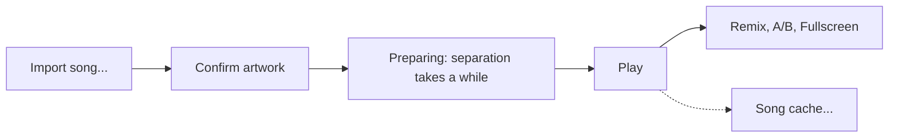

# User guide

This page follows one song from import to playback. Button names are the ones in the app.

## The window

From top to bottom:

- **Header:** **Export diagnostics...**, **Song cache...** and **Audio settings...** (right side).
- **Worker status:** one line such as "Worker ready: CUDA on <GPU name>" or "Worker ready: CPU
  (no usable NVIDIA GPU)", with **Show details** and **Re-check**.
- **Import area:** **Import song...**, a **Use the CPU only** checkbox, the progress and status
  text, and a **Recent songs** list with **Open**, **Locate...** and **Remove** buttons.
- **Mix** (shown at all times, greyed out until a song is open): four stem cards (Drums, Bass, Other, Vocals), the tempo and
  effects section, the master section, and **Reset mix**.
- **Player** (at the bottom): the artwork with a line under it that starts with "Visuals:", the
  song details (length, rate, mono or stereo, format, tempo, the original's path), the **Effects**
  switch, **Intensity**, **Fullscreen**, and the transport bar (**Play**/**Pause**, **Stop**, a
  seek slider, the time, **Loop**, **Stem Mix** and **Original**).

## Import a song

1. Press **Import song...** and choose a WAV or MP3. The file must be mono or stereo, at most
   192 kHz and 30 minutes, and WAV must be 16, 24 or 32-bit PCM or 32-bit float. Anything else is refused with a
   sentence saying why and what to do.
2. **Artwork.** SNDS looks for a cover picture inside the file (an MP3's ID3 tag, or an ID3 chunk
   in a WAV).
   - Found: "Artwork found in ...". Press **Use this**, **Choose image...** (PNG, JPEG or GIF), or
     **Use default artwork**.
   - Not found: "No artwork found in ...". Choose an image or press **Use default artwork**, a
     generated cover with a colour picked from the song.
3. Preparation starts. A song that is already prepared skips steps 2 and 3 and opens straight away.

SNDS never changes or copies your file. It refers to it by path and remembers its size and
content hash.

## While it prepares

The status line names the stage. First "Checking <file>" and "Reading the file", then the artwork
question ("Confirm the artwork for <file>"), then "Preparing <file>" with "Starting the worker"
and six numbered steps: "Reading the audio (1 of 6)", "Separating stems", "Aligning stems",
"Detecting the tempo", "Checking the result" and "Saving the song". Separation is the long one.
The estimate reads "about X left in this step" and shows the time spent so far, with "GPU" or
"CPU". It is per step on purpose, because the total is not predictable. [Measured times](testing.md#measured-baselines) give a feel for it.

- **Cancel** stops the worker right away, removes the unfinished files, and leaves nothing
  playable behind. Your original is untouched.
- Only one song is prepared at a time. Import is disabled until it finishes.
- The CUDA GPU is used automatically when the worker confirms it works. **Use the CPU only** forces
  the CPU. If the GPU fails in the middle of a job, press **Retry on CPU**.
- When it finishes, **Play** appears and the taskbar button flashes if SNDS is in the background.

If a step fails, a banner shows one sentence, the next step, and buttons such as **Try again**,
**Choose another file**, **Open logs folder**, or **Export diagnostics...**. **Show details**
has the technical text.

## Play and compare

- **Play/Pause**, **Stop**, and the seek slider move every stem and the original together.
  **Loop** repeats the song.
- **Stem Mix** plays the four stems through your mix. **Original** plays your source file at the
  same position. The two are exclusive and switching is click-free. Switching does not change your
  mix settings.
  Both modes share final output protection at -0.3 dBFS, so peaks above that ceiling are reduced.
- Before enabling Original, SNDS checks the source file's size and SHA-256 in the background,
  then checks alignment. A changed or unreadable original disables A/B while its prepared stems
  remain playable.
- If the original moved or changed, Stem Mix still plays. Both the **Stem Mix** and **Original**
  buttons are greyed out, and the player says "Original unavailable." with the reason. Press
  **Locate Original...** and pick the file. SNDS checks its size and hash, so a different file
  is refused.
- **Audio settings...** opens a window to pick the output device, sample rate and buffer size. If
  the device disappears, playback stops and keeps its position; **Reconnect** (in that window, and
  on the error banner) brings it back.

The audio always plays at the song's speed. Changing the tempo (below) never retimes the music.

## Remix

New songs always start with the default mix: 0 dB, centered, no cuts, no effect sends, nothing
muted or soloed. **The mix is not saved.** Closing the song or the app loses it.

Each **stem card** has:

- A **gain** slider, -infinity to +6 dB, beside a level meter.
- **M** (mute) and **S** (solo). While any stem is soloed, only soloed stems play.
- **More** shows **Pan**, **Low cut** (20 Hz to 1 kHz, off at the left end), **High cut**
  (500 Hz to 20 kHz, off at the right end), **Reverb** send, and **Delay** send.

The **Tempo and effects** section has:

- **Tempo (BPM)**: 20 to 400. Type a value and press Enter, use **×½** or **×2** for half or
  double time, or **Detected** (shown once you have changed it) to go back to the detected tempo.
  A note beside it says where the tempo came from ("Detected from the song", "Set by you
  (detected: 120)", or "Not detected: using 120 BPM until you set one"). The tempo you set is
  saved with the prepared song. The tempo changes only the delay timing and the visuals.
- **Reverb**: a return slider.
- **Delay**: **Division** (1/4, 1/8, Dotted 1/8, 1/8T or 1/16), **Feedback** and **Return**.

The **Master** section has the **Master gain** and a limiter indicator ("Limiter idle", or "Limiter -3.0 dB"
while it works). The indicator describes limiting inside Stem Mix. A final safety limiter after
sample-rate conversion keeps both Stem Mix and Original at or below -0.3 dBFS. Its additional
gain reduction is not shown by this indicator.

**Reset mix** puts every control back to its default.

### Keyboard

Every control can be used without a mouse. On a focused slider:

| Key | Does |
|---|---|
| Left/Right or Up/Down | Fine step |
| Shift+arrow, Page Up/Page Down | Coarse step |
| Home / End | Minimum / maximum |
| Enter | Type an exact value, for example `-6`, `35%`, `L30`, `1/8T`, `128 bpm` |
| Delete or Backspace | Back to the default |

Space presses a focused button or switch.

## Artwork and fullscreen

The artwork reacts to the post-fader audio of each stem: **drums** give rhythmic pulses, **bass**
scale and depth, **vocals** glow, **other** texture, and **pan** shifts the picture slightly and
brightens the panned side. The **Effects** switch turns this off (the artwork becomes still, audio
is not affected), **Intensity** sets how strongly it reacts, and **Original** mode always shows
the still artwork.

The line under the artwork says what is drawing it: "Visuals: GPU" (with the GPU name and frame
rate), "Visuals: CPU (no GPU effects)" or "Visuals: still artwork", and why if it fell back. If
OpenGL is missing or breaks, SNDS falls back automatically (GPU, then CPU renderer, then static
artwork) and shows a notice once. Audio keeps playing.

**Fullscreen** fills the screen with the visuals, a top bar (the song name, the "Visuals:" status
and the **Exit fullscreen (Esc)** button) and a bottom bar (**Play**/**Pause**, a seek slider, the
time, **Effects** and **Intensity**). To leave, press **Esc** or the exit button. In fullscreen,
**Space** plays or pauses, **Left/Right** seek 5 seconds, and **Home** returns to the start.

## Recent songs

The Recent songs list holds up to 20 songs, newest first. Select a row, then press **Open** (or
Enter). A song whose stems are in the cache opens from it, even if the original moved; its row
adds "original not found". A song that is not in the cache says "Not prepared on this computer.
Opening prepares it.", or "Not prepared and the original is missing. Locate it or remove." when
the file is gone too. **Locate...** finds the original, and **Remove** forgets the row without
touching the cache.

## The song cache

Prepared songs reopen without running separation again. Source identity and alignment checks
run in the background; their time depends on the original's size and storage speed. Songs live in
`%LOCALAPPDATA%\snds\cache`. Nothing is removed unless you remove it.

**Song cache...** lists every folder in the cache: playable songs (length, size, prepared date),
entries made by another SNDS version, and damaged ones, each with the reason. The summary shows
how many songs there are and how much disk space they use.

- **Open** opens a playable song from the cache.
- **Verify** scans the selected song's stem headers and audio samples in the background, and
  compares saved content hashes when present. Playback remains available and no files are changed.
  New preparations save hashes. Older songs can pass the audio checks but cannot be confirmed
  unchanged; delete and reimport one if you want saved checksums. A failed check identifies the
  stem and suggests re-preparation.
- **Delete** removes the selected entry, asking first for a playable song.
- **Clear cache...** removes every entry after asking.
- Deleting or clearing the song that is open closes it first.

A song uses about 5 GB per hour of audio (four float32 stereo stems); a 3-minute song is about 250 MB.

## When something goes wrong

Every failure shows what happened and what to do next. For environment problems, run
`scripts\diagnostics.ps1`; for anything else, use **Export diagnostics...**. See
[Diagnostics](diagnostics.md). Limits of the alpha are listed in
[Known limitations](known-limitations.md).
